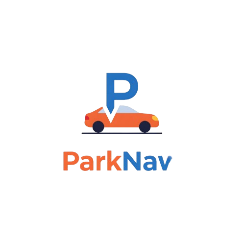

# ParkNav

<div align="center">
  
</div>

## About The Project

ParkNav is a modern, intelligent parking solution that helps drivers find, reserve, and navigate to available parking spots in real-time. Built with React and TypeScript, it provides a seamless experience for urban parking with AI-powered recommendations, live availability updates, and instant booking capabilities.

The app addresses the common frustration of finding parking in busy urban areas by aggregating real-time parking data, providing smart routing, and enabling hassle-free reservations—all in one intuitive interface.

### Key Features

- **Real-time Parking Availability**: Live updates every 30 seconds showing available spots across the city
- **Smart Search & Recommendations**: AI-powered suggestions based on your destination and preferences
- **Interactive Map View**: Visual parking markers with color-coded availability status
- **Instant Booking & Payment**: Reserve spots with UPI, cards, or digital wallets
- **Turn-by-Turn Navigation**: Integrated routing to guide you directly to your parking spot
- **Parking Analytics**: Demand heatmaps and forecasting to help plan your trips
- **Favorites & History**: Save frequently used spots and track your parking history
- **Multi-Vehicle Support**: Manage multiple vehicles in your profile
- **Security Features**: All parking lots verified with CCTV and security details
- **EV Charging Finder**: Locate parking spots with electric vehicle charging stations

## Built With

- **Frontend Framework**: React 19.2.4 with TypeScript
- **Build Tool**: Vite 7.3.1
- **Routing**: React Router DOM 7.13.1
- **UI Components**: Radix UI primitives
- **Styling**: Tailwind CSS 4.2.1
- **Animations**: Framer Motion 12.36.0
- **Icons**: Lucide React
- **Charts**: Recharts 2.15.0
- **Forms**: React Hook Form 7.54.2
- **Notifications**: Sonner (toast notifications)

## Prerequisites

Before you begin, ensure you have the following installed:

- **Node.js** (v18 or higher)
- **npm** (v9 or higher) or **bun** (v1.0 or higher)
- A modern web browser (Chrome, Firefox, Safari, or Edge)

## Installation

1. Clone the repository
```bash
git clone https://github.com/yourusername/parknav.git
cd parknav
```

2. Install dependencies
```bash
npm install
# or
bun install
```

3. Start the development server
```bash
npm run dev
# or
bun run dev
```

4. Open your browser and navigate to `http://localhost:5173`

## Usage

### For Development

```bash
# Start development server
npm run dev

# Build for production
npm run build

# Preview production build
npm run preview

# Run linter
npm run lint
```

## Project Structure

```
parknav/
├── public/
│   ├── logo.png              # App logo
│   └── robots.txt            # SEO configuration
├── src/
│   ├── assets/               # Static assets (images, icons)
│   ├── components/
│   │   ├── Map/              # Map-related components
│   │   │   ├── MapView.tsx
│   │   │   └── ParkingMap.tsx
│   │   ├── Navigation/       # Navigation components
│   │   │   ├── BottomNav.tsx
│   │   │   └── NavigationBar.tsx
│   │   ├── ParkingSpots/     # Parking spot components
│   │   │   ├── ParkingSpotCard.tsx
│   │   │   ├── ParkingSpotList.tsx
│   │   │   ├── SortButton.tsx
│   │   │   └── SpotDetails.tsx
│   │   └── ui/               # Reusable UI components (Radix UI)
│   ├── data/
│   │   ├── mockData.ts       # Mock data for development
│   │   └── mockParkingData.ts
│   ├── hooks/                # Custom React hooks
│   │   ├── use-mobile.tsx
│   │   └── use-toast.ts
│   ├── lib/
│   │   └── utils.ts          # Utility functions
│   ├── pages/                # Page components
│   │   ├── Dashboard.tsx     # Main dashboard
│   │   ├── Home.tsx          # Landing page
│   │   ├── MapPage.tsx       # Map view
│   │   ├── History.tsx       # Booking history
│   │   ├── Favorites.tsx     # Saved spots
│   │   ├── Profile.tsx       # User profile
│   │   ├── Settings.tsx      # App settings
│   │   ├── Vehicles.tsx      # Vehicle management
│   │   ├── Notifications.tsx # Notifications
│   │   └── PaymentMethods.tsx
│   ├── types/                # TypeScript type definitions
│   │   ├── index.ts
│   │   └── parking.ts
│   ├── App.tsx               # Main app component
│   ├── main.tsx              # App entry point
│   └── index.css             # Global styles
├── index.html
├── package.json
├── tsconfig.json
├── vite.config.ts
└── README.md
```

## Features in Detail

### Smart Search
AI-powered search that learns from your parking patterns and suggests the best spots based on:
- Your destination
- Time of day
- Historical availability
- Price preferences
- Required amenities (EV charging, covered parking, etc.)

### Live Map Navigation
Interactive map interface featuring:
- Color-coded parking markers (green = available, amber = limited, red = full)
- Real-time user location tracking
- Turn-by-turn navigation
- Traffic-aware routing
- Parking lot details on tap

### Booking System
Seamless reservation process with:
- One-tap booking
- Multiple payment options (UPI, cards, wallets)
- Instant confirmation
- QR code for contactless entry
- Booking modifications and cancellations

### Analytics Dashboard
Insights to help you park smarter:
- Parking demand heatmaps
- Peak hour predictions
- Cost analysis
- Time-saving statistics
- Personalized recommendations

### Security & Safety
All parking locations include:
- CCTV coverage details
- Security personnel information
- Lighting conditions
- User ratings and reviews
- Emergency contact information

## License

Distributed under the MIT License. See `LICENSE` for more information.
